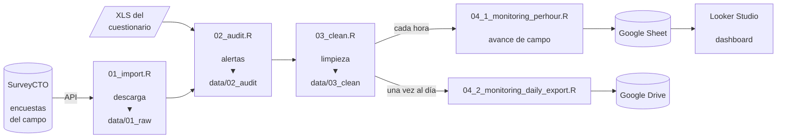
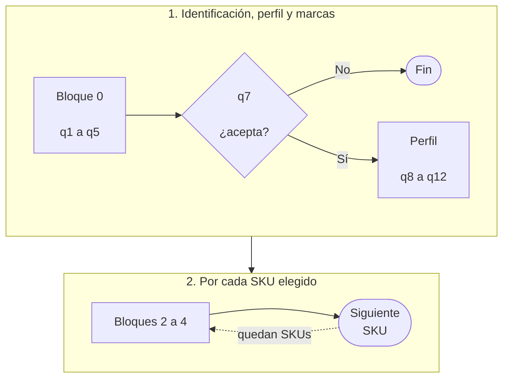
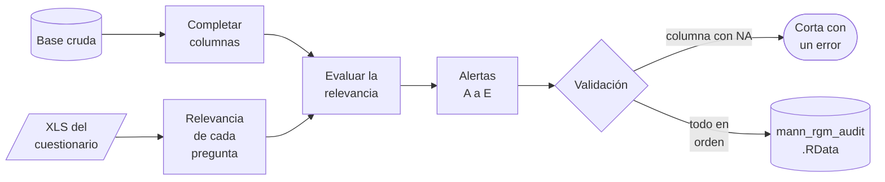

# README de un proyecto de datos

Destilado del README de `pipeline-mann-pricing-rgm`. El objetivo es que alguien
que llega al repo entienda **en 30 segundos** qué hace el proyecto, en qué
estado está y cómo fluyen los datos, sin abrir un script, y que encuentre el
detalle más abajo cuando lo necesite.

Regla general: **todo lo que se puede dibujar va como diagrama o tabla, no como
párrafo.** El texto va entre los gráficos, en frases cortas.

---

## 1. Orden de las secciones

```
Portada (centrada)
  banner SVG · título · una línea · lugares · badges
Nota de estado ([!NOTE])
---
Párrafo de dos o tres frases: qué hacemos y cómo
---
Contenido (índice numerado)
---
1. Estado del proyecto        tabla Etapa | Estado
2. Flujo de datos             flowchart LR + una frase
3. Estructura del repositorio árbol en bloque de código
4. Configuración              4.1 variables · 4.2 secrets de GitHub
5. Scripts                    tabla Script | Qué hace | Salida
6. Automatización             gantt + tabla de horarios
7. <El tema propio>           ej: Auditoría, con sus subsecciones
```

- Cada sección mayor va separada por `---`.
- Los títulos llevan número: `## 1. Estado del proyecto`, `### 4.1 Variables de
  entorno`. El índice enlaza con anclas: `[Estado del proyecto](#1-estado-del-proyecto)`.
- Las secciones 1 a 6 son las mismas en todos los proyectos. La 7 en adelante es
  lo propio del proyecto (auditoría, modelo, indicadores).

---

## 2. Portada

```markdown
<div align="center">


# Pipeline MANN Pricing RGM

**Pipeline de datos de la encuesta de precios y valoración de producto de pañales Mimo y yerba mate Santo Tomás.**

Luque · Limpio · Ñemby · Capiatá · San Lorenzo


</div>

> [!NOTE]
> **En campo desde el 12/10/2026.** La descarga, la auditoría [...] están listas. La limpieza [...] están pendientes: el detalle está en el [estado del proyecto](#1-estado-del-proyecto).
```

- **Todo centrado** dentro de `<div align="center">`, con líneas en blanco
  alrededor del markdown para que GitHub lo procese.
- **Una sola línea en negrita** debajo del título: qué es, en una frase.
- **Línea de lugares o alcance** con `·` como separador.
- **Badges de shields.io**, uno por herramienta, con el formato
  `https://img.shields.io/badge/<texto>-<valor>-<color>`. Espacios como `%20`,
  tildes codificadas (`%C3%B3` es ó). El primero siempre es **estado**, en ámbar.
- **La nota de estado** (`> [!NOTE]`) dice en una línea en qué está el proyecto
  y qué falta, y enlaza a la sección 1. Se actualiza cada vez que cambia el
  estado.

### 2.1 Paleta

La misma en el banner, los badges y cualquier figura:

| Color | Hex | Uso |
|---|---|---|
| Verde muy oscuro | `064E3B` | fondo del banner, badge de la fuente |
| Verde oscuro | `065F46` | fondo del banner, badge del lenguaje |
| Azul | `1E3A8A` | final del degradado, badge de la automatización |
| Verde azulado | `0F766E` | badge del respaldo |
| Índigo | `4338CA` | badge del dashboard |
| Ámbar | `F59E0B` / `FBBF24` | acento: estado, alertas, lo que se quiere destacar |
| Verde claro | `6EE7B7` / `D1FAE5` / `ECFDF5` | textos y detalles sobre el fondo oscuro |

---

## 3. El banner

Un SVG propio en `sources/02_images/banner.svg`, **escrito a mano**, sin
imágenes externas. La plantilla está en `skill_readme_banner.svg`, junto a esta
skill: se copia y se cambian los textos, el ícono y la tarjeta.

Anatomía (1200 × 340, esquinas redondeadas de 28):

```
┌──────────────────────────────────────────────────────────────────────┐
│                                                          ┌────────┐  │
│   [ÍCONO]     TÍTULO GRANDE (58, negrita)                │ mini   │  │
│   del tema    subtítulo: qué hace (19)                   │ gráfico│  │
│               productos · lugar (19, más tenue)          │ del    │  │
│  etiqueta     (Fuente) › (Auditoría) › (Limpieza) › ...  │ tema   │  │
│               ● ● ● ● ● ● ● ● ●  leyenda de los puntos   └────────┘  │
└──────────────────────────────────────────────────────────────────────┘
```

| Pieza | Qué es | En MANN |
|---|---|---|
| Fondo | degradado diagonal verde oscuro → azul | `#064E3B` → `#065F46` → `#1E3A8A` |
| Ícono (izquierda) | una forma simple que diga el tema, en ámbar | etiqueta de precio con "Gs" |
| Título | el nombre del proyecto, blanco, 58 px, negrita | MANN Pricing RGM |
| Subtítulos | qué hace y sobre qué, verde muy claro | pañales Mimo · yerba Santo Tomás |
| Píldoras | las etapas del pipeline, separadas por `›` | SurveyCTO › Auditoría › Limpieza › ... |
| Puntos | los registros, algunos en ámbar | encuestas, en amarillo las con alerta |
| Tarjeta (derecha) | un mini gráfico del análisis central | curvas de Van Westendorp |

Reglas:

- Tipografía `'Segoe UI', Ubuntu, system-ui, sans-serif`, definida en un
  `<style>` con clases (`.t`, `.sub`, `.lbl`).
- `role="img"` y `aria-label` con el nombre del proyecto.
- Las píldoras miden unos **9 px por letra + 20** de ancho, con 14 px de
  separación y un `›` en el medio.
- Nada de texto chico ilegible: el mínimo es 12 px.
- Antes de entregarlo, **abrirlo en el navegador** y revisar que ningún texto se
  salga de su caja.

---

## 4. Tablas

Las tablas son la forma por defecto de presentar cualquier lista con más de un
atributo.

**Estado del proyecto** (sección 1):

```markdown
| Etapa | Estado |
|---|---|
| Descarga desde SurveyCTO (`01_import.R`) | ✅ Listo |
| Limpieza (`03_clean.R`) | Etiquetas listas; correcciones pendientes |
| Dashboard en Looker Studio | Pendiente |
```

`✅ Listo` para lo terminado; para lo demás, una frase que diga qué falta, no
solo "Pendiente" si hay algo hecho.

**Scripts** (sección 5): `Script | Qué hace | Salida`. "Qué hace" en una o dos
frases, con un ejemplo concreto si aclara (`q2_ciudad = 3` pasa a `Ñemby`).
"Salida" con la ruta del archivo.

**Configuración** (sección 4): `Variable | Qué es` y `Secret | Contenido`.
Nunca un valor real: solo el nombre y para qué sirve.

**Tablas del tema propio**: con un código corto en la primera columna y todas
las columnas que hagan falta para no tener que explicar en prosa. En MANN, las
alertas: `ID | Código | Alerta | Qué detecta | Regla | Nivel | Tipo`.

---

## 5. Diagramas (Mermaid)

GitHub renderiza Mermaid en bloques ` ```mermaid `. Se usan cuatro tipos.

### 5.1 Flujo de datos (sección 2) — `flowchart LR`



Convenciones de formas, siempre las mismas:

| Forma | Sintaxis | Para qué |
|---|---|---|
| Cilindro | `ID[("texto")]` | fuentes y destinos de datos: APIs, Sheets, Drive, bases |
| Paralelogramo | `ID[/"texto"/]` | archivos de insumo: el XLS, un diccionario |
| Rectángulo | `ID["texto"]` | un script o un proceso |
| Rombo | `ID{"texto"}` | una decisión o una validación |
| Estadio | `ID(["texto"])` | un final: "Fin", "Corta con un error", "Siguiente SKU" |

- **Nodo de script**: nombre del archivo, línea vacía, verbo, `▼`, carpeta de
  salida: `"01_import.R<br/><br/>descarga<br/>▼<br/>data/01_raw"`.
- **Texto de las flechas** (`-->|cada hora|`) solo para la frecuencia, el medio
  (`API`) o la condición (`Sí`, `No`).
- Saltos de línea con `<br/>`, todo el texto entre comillas, y **nodos angostos**
  (tres o cuatro palabras por línea) para que el diagrama no se aplaste.
- Abajo del diagrama, una o dos frases que digan la regla del flujo: "Cada
  script lee lo que dejó el anterior y guarda su salida en su propia carpeta".

### 5.2 Corridas automáticas (sección 6) — `gantt`

```mermaid
gantt
    title Corridas del pipeline (hora de Paraguay)
    dateFormat HH:mm
    axisFormat %H:%M
    todayMarker off
    section Por hora
    Una corrida por hora :active, 08:17, 10h
    section Diaria
    Cierre del día :crit, 19:17, 20m
```



- En **hora local**, y el título lo dice.
- `:active` para la corrida frecuente y `:crit` para la de cierre: quedan en
  colores distintos.
- Debajo, la tabla `Workflow | Qué corre | Horario (local) | Horario (UTC)`, con
  el cron en código.

### 5.3 Flujo del instrumento o del proceso propio — `flowchart TB` con subgrafos

Para explicar un recorrido con etapas (el cuestionario, un modelo):



- Cada subgrafo es una etapa, numerada en su título, con `direction LR` adentro.
- Los subgrafos se unen entre sí (`F1 --> F2`), no nodo con nodo.
- **Flecha punteada** (`-.->`) para los bucles y las repeticiones.

### 5.4 Cómo trabaja un script — `flowchart LR` con validación

El último diagrama de la sección propia: los pasos del script principal, con la
validación como rombo y la salida de error como estadio.



Debajo, una lista con **negrita al inicio** de cada viñeta que explique los
pasos no obvios: `- **Columnas faltantes:** el JSON de SurveyCTO no trae...`

---

## 6. Árbol del repositorio (sección 3)

En un bloque de código sin lenguaje, con los comentarios **alineados en una
columna**:

```
pipeline-mann-pricing-rgm/
├── .github/workflows/
│   ├── workflow_man_rgm_hourly.yml   corrida por hora: actualiza el Sheet del dashboard
│   └── workflow_man_rgm_daily.yml    corrida de cierre del día: sube a Google Drive
├── data/                             datos (en el repositorio van solo las carpetas)
│   ├── 01_raw/                       descarga cruda de SurveyCTO
...
```

Los caracteres `├──`, `│`, `└──`. Un comentario por carpeta y por archivo que
no se explique solo. Debajo, una o dos frases sobre la regla de la estructura.

---

## 7. Redacción

- **Español, primera persona plural**: "Descargamos las encuestas", "Los
  calibramos con los primeros días de campo".
- **Frases cortas.** Un párrafo de más de cuatro líneas es una tabla o una lista
  que no se hizo.
- **Números concretos**, no "algunos" ni "varios": "faltaban 88 preguntas y 12
  dummies".
- **Nombres de archivos, columnas y variables en código**: `02_audit.R`,
  `q5_categoria`, `GSHEET_ID_MONITORING`.
- **Nunca un valor secreto**: ni ids de Sheets, ni carpetas de Drive, ni
  usuarios.
- Al citar otra parte: "sección 7.2", nunca `§7.2`.
- Fechas en formato local: 12/10/2026.

---

## 8. Mantenerlo vivo

El README describe el estado real del repo. Cada vez que cambia algo de esto, se
actualiza en el mismo commit:

| Si cambia... | Se actualiza |
|---|---|
| una etapa termina o se agrega | la nota de estado, la sección 1 y el badge de estado |
| un script nuevo o renombrado | el flujo (2), el árbol (3) y la tabla de scripts (5) |
| una variable o un secret | la sección 4 |
| el horario de un workflow | el gantt y la tabla de la sección 6 |
| el instrumento | las tablas y los diagramas de la sección propia |

---

## 9. Checklist

- [ ] Portada centrada con banner propio, título, línea en negrita, lugares y
      badges con la paleta.
- [ ] Nota de estado al día, enlazada a la sección 1.
- [ ] Índice numerado con anclas que funcionan.
- [ ] Secciones 1 a 6 en el orden de la sección 1 de esta skill.
- [ ] Flujo de datos con las formas de la sección 5.1 (cilindro, paralelogramo,
      rectángulo, rombo, estadio).
- [ ] Gantt en hora local y tabla con los crons en UTC.
- [ ] Árbol con comentarios alineados.
- [ ] Tablas en vez de párrafos para cualquier lista con atributos.
- [ ] Ningún valor secreto.
- [ ] El banner revisado en el navegador.
