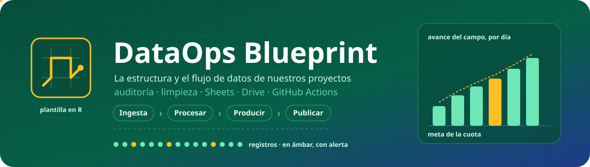
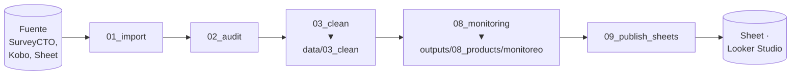
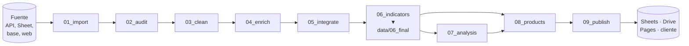

<div align="center">



**La estructura y el flujo de datos que siguen nuestros proyectos de datos.**

Se clona, se renombra y se completa. Sirve igual para una encuesta de una sola ronda que para un proyecto con varias fuentes, varias rondas y análisis.


</div>

> [!NOTE]
> **Por ahora el repositorio solo define la estructura.** Los scripts tienen su encabezado, pero todavía no tienen contenido.

---

## Contenido

1. [Cómo usar este blueprint](#1-cómo-usar-este-blueprint)
2. [El flujo de los datos](#2-el-flujo-de-los-datos)
3. [Las etapas](#3-las-etapas)
4. [Dónde queda cada cosa](#4-dónde-queda-cada-cosa)
5. [Estructura del repositorio](#5-estructura-del-repositorio)
6. [Las carpetas que no son del pipeline](#6-las-carpetas-que-no-son-del-pipeline)
7. [Cómo escala](#7-cómo-escala)
8. [Cómo calzan los proyectos que ya tenemos](#8-cómo-calzan-los-proyectos-que-ya-tenemos)
9. [Reglas que no se negocian](#9-reglas-que-no-se-negocian)

---

## 1. Cómo usar este blueprint

1. **Use this template** en GitHub y nombrar el repositorio `pipeline_<proyecto>`.
2. Renombrar `dataops-blueprint.Rproj` a `<proyecto>.Rproj`.
3. Borrar las etapas que el proyecto no usa (su carpeta en `src/` y `data/`, y su paso en los workflows). **Los números de las demás no cambian.**
4. Copiar `.secrets/.Renviron.example` como `.secrets/.Renviron`, completar los valores y dejar la clave de Google en `.secrets/`.
5. Completar `sources/rondas.csv` y dejar el instrumento en `sources/01_instrumento/`.
6. Completar `.claude/CONTEXTO_PROYECTO.md` y el README siguiendo `.claude/skills/skill_readme.md`.
7. Llenar `src/00_setup/packages.R` y correr `renv::init()` para generar `renv.lock`.

Este blueprint es para **proyectos con datos tabulares**. Un proyecto cualitativo o de revisión de literatura no usa estas etapas.

---

## 2. El flujo de los datos

Hay **dos flujos**, que comparten las tres primeras etapas y corren con workflows distintos:

| Flujo | Para qué | Etapas | Workflow | Cuándo |
|---|---|---|---|---|
| **Monitoreo** | seguir el campo mientras ocurre: avance, cuotas, alertas, encuestadores | `01` → `02` → `03` → `08_monitoring` → `09_publish_sheets` | `hourly.yml` | cada hora, solo mientras dura el levantamiento |
| **Completo** | la base final, el análisis y las entregas | `01` → `02` → … → `06` → `07` → `08` → `09` | `daily.yml` | una vez al día, o a mano al cierre |

### 2.1 Flujo de monitoreo



Es corto a propósito: corre cada hora y tiene que terminar rápido. Lee la base **limpia pero sin filtrar**: están todos los intentos, con sus alertas y su clasificación, porque el monitoreo mide el proceso de campo, incluidas las encuestas inválidas. Las etapas `04` a `07` no participan.

### 2.2 Flujo completo



Se lee en tres bloques:

| Bloque | Etapas | Para quién es | Escribe en |
|---|---|---|---|
| **Preparar los datos** | `01` a `06` | para el pipeline: cada script lee lo que dejó el anterior | `data/` |
| **Analizar y producir** | `07` y `08` | para una persona: lo que se mira, se analiza o se entrega | `outputs/` |
| **Publicar** | `09` | para un sistema: llevarlo a donde se mira | Sheets, Drive, Pages |

---

## 3. Las etapas

Cada etapa responde **una sola pregunta**. Si una tarea no responde la pregunta de la etapa, no va ahí.

| # | Etapa | La pregunta que responde | Lee | Escribe | ¿Se puede saltar? |
|---|---|---|---|---|---|
| `00` | `setup` | ¿Qué necesita todo script para correr? | — | — | No |
| `01` | `import` | ¿Qué llegó de la fuente? | la fuente | `data/01_raw/` | No |
| `02` | `audit` | ¿Está bien lo que llegó? | `data/01_raw/` | `data/02_audit/` | Sí |
| `03` | `clean` | ¿Cómo queda usable, una fuente a la vez? | `data/02_audit/` | `data/03_clean/` | No |
| `04` | `enrich` | ¿Qué le agregamos desde afuera? | `data/03_clean/` | `data/04_enrich/` | Sí |
| `05` | `integrate` | ¿Cómo se unen fuentes y rondas? | `data/04_enrich/` | `data/05_integrate/` | Sí |
| `06` | `indicators` | ¿Qué variables e indicadores necesitamos? | la última etapa | `data/06_final/` | No |
| `07` | `analysis` | ¿Qué resultados obtenemos? | `data/06_final/` | `outputs/07_analysis/` | Sí |
| `08` | `products` | ¿Qué mira o recibe una persona? | `data/06_final/`, `outputs/07_analysis/` | `outputs/08_products/` | Sí |
| `09` | `publish` | ¿Dónde tiene que estar? | `outputs/`, `data/` | Sheets, Drive, Pages | Sí |

Lo que hace cada una, y sobre todo lo que **no** hace:

- **`01_import`** descarga tal cual. **No** filtra ni corrige. Si la fuente responde con error, corta sin pisar el crudo anterior.
- **`02_audit`** marca. **No** corrige ni borra: agrega columnas de alerta y clasifica cada registro. Aplica los veredictos humanos.
- **`03_clean`** corrige, normaliza y etiqueta **una fuente a la vez**. **No** carga ninguna otra fuente.
- **`04_enrich`** agrega información que la fuente no trae: IA, geocodificación, APIs externas. **No** vuelve a procesar lo que no cambió.
- **`05_integrate`** une fuentes y rondas: apila, cruza, deduplica, resuelve quién es quién. **No** crea indicadores.
- **`06_indicators`** crea variables derivadas, indicadores y scores sobre la base integrada, y deja la base final en dos versiones: la analítica y la de entrega sin datos personales. **No** limpia.
- **`07_analysis`** calcula resultados: modelos, índices, cruces. Guarda tablas y figuras; **nunca** quedan solo en pantalla.
- **`08_products`** arma lo que mira una persona: tablas del dashboard, informes, diccionario, base de entrega.
- **`09_publish`** lleva cada cosa a su destino. **No** calcula nada.

**`04_enrich` frente a `06_indicators`:** las dos agregan columnas, pero `04` trae información **de afuera** (IA, APIs, geocodificación), una fuente a la vez y antes de integrar; `06` calcula con lo que **ya está adentro**, después de integrar, cuando ya están todas las fuentes y rondas juntas. Las recodificaciones simples de una sola fuente (tramos de edad, grupos de NPS) se quedan en `03_clean`.

**Los números no se corren.** Si un proyecto no tiene enriquecimiento, no existe `04_enrich`, y `05_integrate` sigue siendo `05`. Así, en todos los proyectos `03` es limpieza y `06` es la base final.

---

## 4. Dónde queda cada cosa

La regla es **qué es y quién lo lee**:

| Si es… | Va en | Nombre del archivo | En git |
|---|---|---|---|
| una base de datos que lee otro script | `data/0N_<etapa>/` | fijo, se sobrescribe en cada corrida | no, solo las carpetas |
| un resultado, tabla, gráfico o informe | `outputs/0N_<etapa>/<nombre>/` | con fecha, se acumula | no, solo las carpetas |
| algo que lee un sistema (Looker, la web) | su destino: Sheets, Drive, Pages | lo decide el destino | — |
| un insumo que entra de afuera | `sources/` | lo decide el equipo | sí |

**En `data/` solo van bases de datos.** Ninguna tabla de resultados, gráfico ni informe.

`data/06_final/` es la **frontera**: de ahí para atrás todo es preparación; de ahí para adelante, todo usa la base final. La única excepción es el flujo de monitoreo (`08_monitoring_*`), que lee de `data/03_clean/` porque mide el proceso de campo mientras ocurre (sección 2.1).

---

## 5. Estructura del repositorio

```
<proyecto>/
├── README.md                              qué es el proyecto, en qué estado está y cómo correrlo
├── <proyecto>.Rproj                       abre el proyecto en RStudio o Positron
├── renv.lock                              versiones exactas de los paquetes (renv::snapshot())
├── .gitignore                             qué NO se sube: datos, productos, credenciales
│
├── .claude/                               contexto y reglas para programar con Claude
│   ├── CLAUDE.md                          qué leer al empezar y qué actualizar al terminar
│   ├── CONTEXTO_PROYECTO.md               ficha, estado actual, decisiones, pendientes y bitácora
│   └── skills/                            cómo se hace cada tarea: estructura, estilo, auditoría, limpieza, README
│
├── .github/
│   ├── images/                            banner y diagramas que muestra el README
│   └── workflows/                         automatización: hourly.yml (monitoreo), daily.yml (flujo completo),
│                                          dashboard.yml (opcional, publica tools/dashboard)
│
├── .secrets/                              credenciales; en git solo .gitkeep y .Renviron.example
│                                          (.Renviron con los valores y la clave .json quedan locales)
│
├── sources/                               insumos que entran de afuera; el pipeline los lee pero NO los produce
│   ├── rondas.csv                         una fila por ronda: formid, fechas, instrumento y estado
│   ├── 01_instrumento/                    el cuestionario de cada ronda: <ronda>_<version>.xlsx
│   ├── 02_referencias/                    catálogos, metas, umbrales, listas de prueba, prompts
│   └── 03_correcciones/                   correcciones del analista, sin datos personales
│
├── src/                                   todo el código del pipeline
│   ├── 00_master.R                        corre los dos flujos en orden, solo para probar en local
│   ├── 00_setup/                          lo que carga todo script: paquetes, funciones y autenticación
│   ├── 01_import/                         un script por fuente: descarga los datos tal cual llegan
│   ├── 02_audit/                          un script por fuente: marca alertas 0/1, sin corregir ni borrar
│   ├── 03_clean/                          un script por fuente: corrige, normaliza y etiqueta
│   ├── 04_enrich/                         un script por fuente: agrega información de afuera (IA, APIs)
│   ├── 05_integrate/                      pasos con subíndice: une fuentes y rondas, resuelve quién es quién
│   ├── 06_indicators/                     un script por tema: variables derivadas, indicadores, versión de entrega
│   ├── 07_analysis/                       un script por análisis: modelos, índices, cruces
│   ├── 08_products/                       un script por producto: monitoreo, informes, entregas
│   └── 09_publish/                        un script por destino: Sheets, Drive, Pages
│
├── data/                                  SOLO bases de datos .RData (en git solo las carpetas)
│   ├── 01_raw/                            lo que llegó de cada fuente, tal cual; una subcarpeta por ronda
│   ├── 02_audit/                          cada fuente con sus alertas marcadas; una subcarpeta por ronda
│   ├── 03_clean/                          cada fuente limpia y etiquetada; una subcarpeta por ronda
│   ├── 04_enrich/                         cada fuente con la información agregada; una subcarpeta por ronda
│   ├── 05_integrate/                      todas las fuentes y rondas en una sola base
│   └── 06_final/                          la base analítica y la de entrega: la frontera que leen 07 y 08
│
├── outputs/                               todo lo que NO es base de datos (en git solo las carpetas)
│   ├── 07_analysis/                       los resultados de todos los análisis, con su nombre como prefijo
│   │   ├── tablas/                        descriptivos_<tabla>.csv, modelo_<tabla>.csv
│   │   └── figuras/                       descriptivos_<figura>.png, modelo_<figura>.png
│   └── 08_products/                       una carpeta por producto, con fecha en cada archivo
│       ├── monitoreo/                     las tablas del campo que 09_publish_sheets sube a Looker
│       ├── informe/                       informe_<aaaa-mm-dd>.docx
│       └── entrega/                       entrega_<aaaa-mm-dd>/ con .xlsx, .csv, .dta y diccionario
│
└── tools/                                 (opcional) código que corre fuera del pipeline
    ├── apps_script/                       el disparador que lanza los workflows a su hora
    └── dashboard/                         el dashboard web propio que se publica en GitHub Pages
```

El repositorio trae scripts de ejemplo en cada carpeta de `src/` (una encuesta y un registro como fuentes) y las subcarpetas `piloto/`, `ronda_1/`, `ronda_2/` y `ronda_3/` en `data/01_raw` a `04_enrich`: cada proyecto los renombra o borra según sus fuentes y rondas. La sección 7 muestra qué archivo escribe cada script. Si una corrida deja varios archivos de un mismo producto, van en una subcarpeta con la fecha de corte.

---

## 6. Las carpetas que no son del pipeline

| Carpeta | Qué va | Qué **no** va |
|---|---|---|
| `sources/` | lo que entra de afuera y no cambia con cada corrida: rondas, cuestionario, catálogos, metas, prompts, correcciones del analista | nada que produzca el pipeline; ningún dato personal |
| `outputs/` | resultados de `07` y productos de `08`, con fecha | bases que lea otro script |
| `tools/apps_script/` | el Apps Script que dispara los workflows | lógica del pipeline |
| `tools/dashboard/` | el código de un dashboard web propio (HTML para GitHub Pages) | el dashboard de Looker Studio: ese vive en Looker y lee un Sheet |
| `.github/images/` | el banner y las figuras del README | gráficos de resultados (van en `outputs/`) |
| `.github/workflows/` | un workflow por frecuencia, un paso por script | lógica: los workflows solo llaman scripts |
| `.claude/` | el contexto y las skills para trabajar con Claude | la configuración personal (`settings.local.json`) |
| `.secrets/` | `.Renviron` y las claves que son archivo | nada fuera de esta carpeta tiene un valor secreto |

Las reglas de cómo documentar (orden del README, plantilla del banner) están en `.claude/skills/skill_readme.md` y `skill_readme_banner.svg`. El resultado de aplicarlas (el banner de este proyecto) va en `.github/images/`.

---

## 7. Cómo escala

La estructura **no cambia**; solo se agregan archivos dentro de las mismas carpetas.

**Varias fuentes:** un script por fuente en `01` a `04`, y se unen en `05`.

```
src/01_import/01_import_encuesta.R         ─►  data/01_raw/<ronda>/<proyecto>_encuesta_raw.RData
src/01_import/01_import_registro.R         ─►  data/01_raw/<ronda>/<proyecto>_registro_raw.RData
src/03_clean/03_clean_encuesta.R           ─►  data/03_clean/<ronda>/<proyecto>_encuesta_clean.RData
src/03_clean/03_clean_registro.R           ─►  data/03_clean/<ronda>/<proyecto>_registro_clean.RData
src/05_integrate/05_integrate_1_apilar.R   ─►  data/05_integrate/<proyecto>_apilada.RData
src/05_integrate/05_integrate_2_entidades.R ─► data/05_integrate/<proyecto>_integrate.RData
```

Una etapa con un solo script (`05_integrate.R`) se divide en pasos con subíndice (`05_integrate_1_`, `05_integrate_2_`) cuando crece o cuando cada paso deja su propia base.

**Varias rondas:** el código es **uno solo** y la ronda es un parámetro. `sources/rondas.csv` dice qué formulario e instrumento usa cada ronda y cuál está activa. Los datos de cada ronda van en una subcarpeta dentro de cada etapa, y `05_integrate` las une.

```
ronda,formid,fecha_inicio,fecha_fin,instrumento,estado
piloto,emcesa_piloto,2026-08-20,2026-08-25,piloto_v3.xlsx,cerrada
ronda_1,emcesa_ronda_1,2026-09-10,2026-10-30,ronda_1_v15.xlsx,cerrada
ronda_2,emcesa_ronda_2,2027-01-15,2027-02-15,ronda_2_v1.xlsx,activa
ronda_3,emcesa_ronda_3,2027-05-10,2027-06-10,ronda_3_v1.xlsx,pendiente
ronda_4,emcesa_ronda_4,2027-09-13,2027-10-13,ronda_4_v1.xlsx,pendiente
```

Las rondas se llaman siempre `ronda_<n>` (sin espacios ni abreviaturas), igual en `rondas.csv`, en las subcarpetas de `data/` y en el nombre del instrumento.

El piloto es una ronda más. Nunca se copia el código por ronda (`src/ronda_1/`): una corrección tiene que llegar a todas.

**Varios análisis y productos:** un script por cada uno. Los análisis escriben todos en `outputs/07_analysis/tablas/` y `figuras/`, con el nombre del análisis como prefijo; cada producto tiene su carpeta en `outputs/08_products/`:

```
src/07_analysis/07_analysis_descriptivos.R  ─►  outputs/07_analysis/tablas/descriptivos_*.csv, figuras/descriptivos_*.png
src/07_analysis/07_analysis_modelo.R        ─►  outputs/07_analysis/tablas/modelo_*.csv, figuras/modelo_*.png
src/08_products/08_products_informe.R       ─►  outputs/08_products/informe/
src/08_products/08_products_entrega.R       ─►  outputs/08_products/entrega/
```

**Decisiones humanas** (validación de supervisoras, correcciones): son una fuente más.

- Si vienen de un Sheet, se importan con `01_import_validacion.R`, y `02_audit` aplica las correcciones (antes de las alertas) y los veredictos (al final).
- Si son correcciones del analista sin datos personales, van en `sources/03_correcciones/`.
- Nunca listas de ids, encuestadores o fechas escritas en el código.

---

## 8. Cómo calzan los proyectos que ya tenemos

| Etapa | BID RDS Diáspora | Mann Pricing | EMCESA | Tigo Jóvenes Conectados | Paraguay Index | Licitaciones |
|---|---|---|---|---|---|---|
| `01_import` | encuestas, semillas, casos, validación | SurveyCTO | SurveyCTO | 6 fuentes | APIs y scraping | 4 portales |
| `02_audit` | 10 dimensiones | alertas A–E | flags `m_`, `out_`, `ale_` | — | contratos de esquema | hash de cambios |
| `03_clean` | etiquetas, códigos | etiquetas, códigos | correcciones | una por fuente | `processing` | `clean_<fuente>` |
| `04_enrich` | — | — | — | — | CPI, población | `enrichAI_<fuente>` |
| `05_integrate` | encuestas + semillas + casos | — | — | base maestra | panel trimestral | apilar fuentes |
| `06_indicators` | base codificada | NPS, tramos | corte | tablas de fases | insumos del índice | score |
| `07_analysis` | conjoint | Van Westendorp | — | diseño muestral | índice | — |
| `08_products` | monitoreo, diccionario, validación | monitoreo, entrega | monitoreo, entrega | Looker, informes | dashboard | — |
| `09_publish` | Sheets, Drive, SurveyCTO | Sheets, Drive | Sheets, Drive | Drive, SFTP | Pages | Sheets |

---

## 9. Reglas que no se negocian

- [ ] El número del script es el mismo que el de la carpeta que escribe.
- [ ] Cada etapa lee **solo** la anterior que exista y escribe **solo** en su carpeta.
- [ ] Los números no se corren: si una etapa no aplica, se borra.
- [ ] En `data/` solo van bases de datos.
- [ ] `07` y `08` leen **solo** de `data/06_final/` (salvo `08_monitoring_*`, que lee de `03_clean`).
- [ ] Nada que produzca el pipeline va en `sources/`.
- [ ] Ninguna credencial, id, UUID ni dato personal en un script: todo sale de `.secrets/.Renviron`, `sources/` o una fuente importada.
- [ ] `.Renviron.example` tiene todas las variables que usa el proyecto.
- [ ] El código es uno solo para todas las rondas.
- [ ] Ningún `View()`, `setwd()` ni ruta con fecha fija en el pipeline; la exploración va en `src/borradores/`.
- [ ] Ningún script de más de ~1.500 líneas: se divide con subíndice.
- [ ] `00_master` es para probar en local; en producción, un paso del workflow por script.
- [ ] El README y `CONTEXTO_PROYECTO.md` se actualizan en el mismo commit que el cambio.
