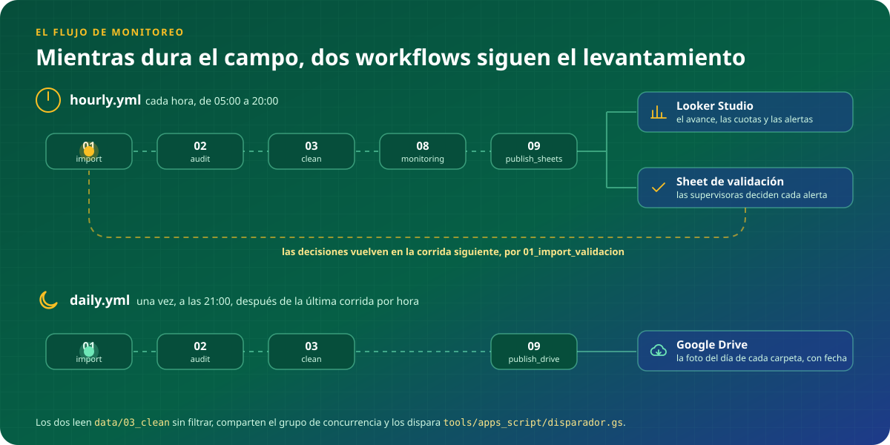

<div align="center">


**La estructura y el flujo de datos que siguen nuestros proyectos de datos.**

Se clona, se renombra y se completa. Sirve igual para una encuesta de una sola ronda que para un proyecto con varias fuentes, varias rondas y análisis.


[](https://piero-valles-maravi.github.io/dataops-blueprint/)

</div>

> [!NOTE]
> **Por ahora el repositorio solo define la estructura.** Los scripts tienen su encabezado, pero todavía no tienen contenido.

---

## Contenido

1. [Cómo usar este blueprint](#1-cómo-usar-este-blueprint)
2. [El flujo de los datos](#2-el-flujo-de-los-datos)
3. [Las etapas](#3-las-etapas)
4. [Dónde queda cada cosa](#4-dónde-queda-cada-cosa)
5. [Estructura del repositorio](#5-estructura-del-repositorio)

---

## 1. Cómo usar este blueprint

1. **Use this template** en GitHub y nombrar el repositorio `pipeline_<proyecto>`.
2. Renombrar `dataops-blueprint.Rproj` a `<proyecto>.Rproj`.
3. Borrar las etapas que el proyecto no usa (su carpeta en `src/` y `data/`, y su paso en los workflows). **Los números de las demás no cambian.**
4. Copiar `.secrets/.Renviron.example` como `.secrets/.Renviron`, completar los valores y dejar la clave de Google en `.secrets/`. Cargar las mismas variables como *secrets* del repositorio en GitHub, con el mismo nombre; la clave va en `GOOGLE_SERVICE_ACCOUNT_JSON`, con el contenido del JSON.
5. Completar `sources/rondas.csv` y dejar el instrumento en `sources/01_instrumento/`.
6. Completar `.claude/CONTEXTO_PROYECTO.md` y el README siguiendo `.claude/skills/skill_readme.md`.
7. Llenar `src/00_setup/packages.R` y correr `renv::init()` para generar `renv.lock`.

Este blueprint es para **proyectos con datos tabulares**. Un proyecto cualitativo o de revisión de literatura no usa estas etapas.

---

## 2. El flujo de los datos

### 2.1 El proceso de un vistazo



Todo proyecto pasa por los mismos cuatro bloques:

| Bloque | Etapas | Qué pasa | Escribe en |
|---|---|---|---|
| **1. Ingesta** | `01` | se traen los datos de cada fuente, tal cual llegan | `data/01_raw/` |
| **2. Procesar** | `02` a `06` | se auditan, limpian, enriquecen e integran hasta dejar la base final | `data/02_audit/` a `data/06_final/` |
| **3. Producir** | `07` y `08` | se analiza la base final y se arma lo que mira o recibe una persona | `outputs/` |
| **4. Publicar** | `09` | se lleva cada cosa a su destino; no se calcula nada | Sheets, Drive, Pages |

### 2.2 El pipeline completo



Las nueve etapas, en orden. Cada script lee lo que dejó el anterior y escribe solo en su carpeta; las etapas que un proyecto no usa se borran sin correr los números.

Corre **a mano**, cuando hay que dejar la base final, los análisis y las entregas: al hacer un corte o al cerrar el campo. Se lanza desde *Actions → completo → Run workflow* (`completo.yml`) o en local con `src/00_master.R`.

### 2.3 El flujo de monitoreo



Mientras dura el campo, dos workflows siguen el levantamiento. Los dos corren las mismas tres etapas (`01` a `03`) y difieren en lo que hacen después:

| Workflow | Cuándo | Etapas | Para qué |
|---|---|---|---|
| `hourly.yml` | cada hora, en la jornada de campo | `01` → `02` → `03` → `08_monitoring` → `09_publish_sheets` | actualiza el Sheet que lee **Looker Studio** y suma al **Sheet de validación** las encuestas nuevas con alerta |
| `daily.yml` | una vez, al cierre del día | `01` → `02` → `03` → `09_publish_drive` | deja en **Google Drive** la última foto del día de cada carpeta de `data/`, con la fecha en el nombre |

- **Lee la base limpia, sin filtrar.** El monitoreo mide el proceso de campo, así que necesita todos los intentos con sus alertas, incluidas las encuestas inválidas. Es la única excepción a la frontera de `data/06_final/`.
- **La validación es un circuito.** Las supervisoras deciden en el Sheet de validación; en la corrida siguiente `01_import_validacion` trae esas decisiones y `02_audit` las aplica.
- **Los dispara un Apps Script** (`tools/apps_script/disparador.gs`), porque el cron de GitHub no es confiable. Los dos workflows comparten el grupo de concurrencia: nunca corren a la vez.

---

## 3. Las etapas

Cada etapa responde **una sola pregunta**. Si una tarea no responde la pregunta de la etapa, no va ahí.

| # | Etapa | La pregunta que responde | Lee | Escribe | ¿Se puede saltar? |
|---|---|---|---|---|---|
| `00` | `setup` | ¿Qué necesita todo script para correr? | — | — | No |
| `01` | `import` | ¿Qué llegó de la fuente? | la fuente | `data/01_raw/` | No |
| `02` | `audit` | ¿Está bien lo que llegó? | `data/01_raw/` | `data/02_audit/` | Sí |
| `03` | `clean` | ¿Cómo queda usable, una fuente a la vez? | `data/02_audit/` | `data/03_clean/` | No |
| `04` | `enrich` | ¿Qué le agregamos desde afuera? | `data/03_clean/` | `data/04_enrich/` | Sí |
| `05` | `integrate` | ¿Cómo se unen fuentes y rondas? | `data/04_enrich/` | `data/05_integrate/` | Sí |
| `06` | `indicators` | ¿Qué variables e indicadores necesitamos? | la última etapa | `data/06_final/` | No |
| `07` | `analysis` | ¿Qué resultados obtenemos? | `data/06_final/` | `outputs/07_analysis/` | Sí |
| `08` | `products` | ¿Qué mira o recibe una persona? | `data/06_final/`, `outputs/07_analysis/` | `outputs/08_products/` | Sí |
| `09` | `publish` | ¿Dónde tiene que estar? | `outputs/`, `data/` | Sheets, Drive, Pages | Sí |

Lo que hace cada una, y sobre todo lo que **no** hace:

- **`01_import`** descarga tal cual. **No** filtra ni corrige. Si la fuente responde con error, corta sin pisar el crudo anterior.
- **`02_audit`** marca. **No** corrige ni borra: agrega columnas de alerta y clasifica cada registro. Aplica los veredictos humanos.
- **`03_clean`** corrige, normaliza y etiqueta **una fuente a la vez**. **No** carga ninguna otra fuente.
- **`04_enrich`** agrega información que la fuente no trae: IA, geocodificación, APIs externas. **No** vuelve a procesar lo que no cambió.
- **`05_integrate`** une fuentes y rondas: apila, cruza, deduplica, resuelve quién es quién. **No** crea indicadores.
- **`06_indicators`** crea variables derivadas, indicadores y scores sobre la base integrada, y deja la base final en dos versiones: la analítica y la de entrega sin datos personales. **No** limpia.
- **`07_analysis`** calcula resultados: modelos, índices, cruces. Guarda tablas y figuras; **nunca** quedan solo en pantalla.
- **`08_products`** arma lo que mira una persona: tablas del dashboard, informes, diccionario, base de entrega.
- **`09_publish`** lleva cada cosa a su destino. **No** calcula nada.

**`04_enrich` frente a `06_indicators`:** las dos agregan columnas, pero `04` trae información **de afuera** (IA, APIs, geocodificación), una fuente a la vez y antes de integrar; `06` calcula con lo que **ya está adentro**, después de integrar, cuando ya están todas las fuentes y rondas juntas. Las recodificaciones simples de una sola fuente (tramos de edad, grupos de NPS) se quedan en `03_clean`.

**Los números no se corren.** Si un proyecto no tiene enriquecimiento, no existe `04_enrich`, y `05_integrate` sigue siendo `05`. Así, en todos los proyectos `03` es limpieza y `06` es la base final.

---

## 4. Dónde queda cada cosa

La regla es **qué es y quién lo lee**:

| Si es… | Va en | Nombre del archivo | En git |
|---|---|---|---|
| una base de datos que lee otro script | `data/0N_<etapa>/` | fijo, se sobrescribe en cada corrida | no, solo las carpetas |
| un resultado, tabla, gráfico o informe | `outputs/0N_<etapa>/<nombre>/` | con fecha, se acumula | no, solo las carpetas |
| algo que lee un sistema (Looker, la web) | su destino: Sheets, Drive, Pages | lo decide el destino | — |
| un insumo que entra de afuera | `sources/` | lo decide el equipo | sí |

**En `data/` solo van bases de datos.** Ninguna tabla de resultados, gráfico ni informe.

`data/06_final/` es la **frontera**: de ahí para atrás todo es preparación; de ahí para adelante, todo usa la base final. La única excepción es el flujo de monitoreo (`08_monitoring_*`), que lee de `data/03_clean/` porque mide el proceso de campo mientras ocurre (sección 2.3).

---

## 5. Estructura del repositorio

El árbol muestra hasta cuatro niveles. Para buscar una carpeta y leer la definición completa de cada una, abre el **[explorador interactivo](https://piero-valles-maravi.github.io/dataops-blueprint/)**.

```
<proyecto>/
├── README.md                              qué es, cómo se usa y cómo está armado
├── dataops-blueprint.Rproj                abre el proyecto en RStudio o Positron
├── renv.lock                              versiones exactas de los paquetes
├── .gitignore                             qué NO se sube a git
│
├── .claude/                               contexto y reglas para programar con Claude
│   ├── CLAUDE.md                          qué leer al empezar y qué actualizar al terminar
│   ├── CONTEXTO_PROYECTO.md               ficha, estado, decisiones, pendientes, bitácora
│   └── skills/                            cómo se hace cada tarea
│       ├── skill_project_structure.md     dónde va cada cosa
│       ├── skill_code_style.md            estilo de código R
│       ├── skill_audit.md                 cómo se audita
│       ├── skill_data_cleaning.md         cómo se limpia una fuente
│       ├── skill_readme.md                cómo se escribe el README
│       └── skill_readme_banner.svg        plantilla del banner
│
├── .github/                               imágenes del README y automatización
│   ├── images/                            banner y figuras del README
│   │   ├── banner.svg                     portada del README
│   │   ├── flujo_macro.svg                animación de los cuatro bloques
│   │   ├── flujo_pipeline.svg             animación de las nueve etapas
│   │   └── flujo_monitoreo.svg            animación del monitoreo
│   └── workflows/                         automatización: un workflow por frecuencia
│       ├── hourly.yml                     monitoreo cada hora: Looker y validación
│       ├── daily.yml                      monitoreo al cierre del día: respaldo en Drive
│       ├── completo.yml                   pipeline completo, a mano
│       └── dashboard.yml                  publica tools/dashboard en Pages
│
├── .secrets/                              credenciales (casi nada se sube)
│   ├── .Renviron.example                  los nombres de las variables, sin valores
│   ├── .Renviron                          (local) los valores
│   └── cuenta_servicio.json               (local) la clave de Google
│
├── sources/                               insumos que el pipeline NO produce
│   ├── rondas.csv                         una fila por ronda
│   ├── 01_instrumento/                    el cuestionario de cada ronda
│   │   └── <ronda>_<version>.xlsx         XLSForm de la ronda
│   ├── 02_referencias/                    catálogos, metas, umbrales, prompts
│   └── 03_correcciones/                   correcciones del analista
│
├── src/                                   todo el código del pipeline
│   ├── 00_master.R                        corre todo el pipeline en local
│   ├── 00_setup/                          lo que carga todo script
│   │   ├── packages.R                     solo paquetes
│   │   ├── functions.R                    solo funciones
│   │   └── auth.R                         solo autenticación
│   ├── 01_import/                         un script por fuente: descarga tal cual
│   │   ├── 01_import_scto.R               la encuesta de SurveyCTO
│   │   ├── 01_import_registro.R           una segunda fuente
│   │   └── 01_import_validacion.R         las decisiones humanas
│   ├── 02_audit/                          un script por fuente: marca alertas
│   │   ├── 02_audit_encuesta.R            auditoría de la encuesta
│   │   └── 02_audit_registro.R            auditoría del registro
│   ├── 03_clean/                          un script por fuente: corrige y etiqueta
│   │   ├── 03_clean_encuesta.R            limpieza de la encuesta
│   │   └── 03_clean_registro.R            limpieza del registro
│   ├── 04_enrich/                         un script por fuente: información de afuera
│   │   ├── 04_enrich_encuesta.R           IA sobre la encuesta
│   │   └── 04_enrich_registro.R           datos externos del registro
│   ├── 05_integrate/                      pasos con subíndice: une fuentes y rondas
│   │   ├── 05_integrate_1_apilar.R        apila fuentes y rondas
│   │   └── 05_integrate_2_entidades.R     resuelve quién es quién
│   ├── 06_indicators/                     un script por tema: indicadores y base final
│   │   ├── 06_indicators_variables.R      variables, indicadores, scores
│   │   └── 06_indicators_entrega.R        versión de entrega
│   ├── 07_analysis/                       un script por análisis
│   │   ├── 07_analysis_descriptivos.R     descriptivos y cruces
│   │   └── 07_analysis_modelo.R           el modelo o índice
│   ├── 08_products/                       un script por producto
│   │   ├── 08_monitoring.R                tablas del monitoreo y casos a validar
│   │   ├── 08_products_informe.R          el informe
│   │   └── 08_products_entrega.R          la entrega al cliente
│   └── 09_publish/                        un script por destino
│       ├── 09_publish_sheets.R            los Sheets: Looker, validación, dashboard
│       └── 09_publish_drive.R             el respaldo en Drive
│
├── data/                                  SOLO bases de datos .RData
│   ├── 01_raw/                            lo que llegó, tal cual
│   │   ├── piloto/                        datos de piloto
│   │   ├── ronda_1/                       datos de ronda_1
│   │   ├── ronda_2/                       datos de ronda_2
│   │   └── ronda_3/                       datos de ronda_3
│   ├── 02_audit/                          cada fuente con sus alertas
│   │   ├── piloto/                        datos de piloto
│   │   ├── ronda_1/                       datos de ronda_1
│   │   ├── ronda_2/                       datos de ronda_2
│   │   └── ronda_3/                       datos de ronda_3
│   ├── 03_clean/                          cada fuente limpia
│   │   ├── piloto/                        datos de piloto
│   │   ├── ronda_1/                       datos de ronda_1
│   │   ├── ronda_2/                       datos de ronda_2
│   │   └── ronda_3/                       datos de ronda_3
│   ├── 04_enrich/                         cada fuente con la información agregada
│   │   ├── piloto/                        datos de piloto
│   │   ├── ronda_1/                       datos de ronda_1
│   │   ├── ronda_2/                       datos de ronda_2
│   │   └── ronda_3/                       datos de ronda_3
│   ├── 05_integrate/                      todas las fuentes y rondas juntas
│   │   └── <proyecto>_integrate.RData     base .RData
│   └── 06_final/                          la frontera
│       ├── <proyecto>_final.RData         base .RData
│       └── <proyecto>_entrega.RData       base .RData
│
├── outputs/                               todo lo que NO es base de datos
│   ├── 07_analysis/                       resultados de todos los análisis
│   │   ├── tablas/                        tablas de resultados
│   │   │   └── descriptivos_<tabla>.csv   una tabla
│   │   └── figuras/                       gráficos
│   │       └── modelo_<figura>.png        una figura
│   └── 08_products/                       una carpeta por producto
│       ├── monitoreo/                     tablas del campo
│       ├── informe/                       informes con fecha
│       │   └── informe_<aaaa-mm-dd>.docx  un informe
│       └── entrega/                       entregas al cliente
│           └── entrega_<aaaa-mm-dd>/      una entrega
│
└── tools/                                 código que corre fuera del pipeline
    ├── apps_script/                       el disparador de los workflows
    │   └── disparador.gs                  el script
    └── dashboard/                         página web en GitHub Pages
        └── index.html                     la página
```

El repositorio trae scripts de ejemplo en cada carpeta de `src/` (una encuesta y un registro como fuentes) y las subcarpetas `piloto/`, `ronda_1/`, `ronda_2/` y `ronda_3/` en `data/01_raw` a `04_enrich`: cada proyecto los renombra o borra según sus fuentes y rondas. Si una corrida deja varios archivos de un mismo producto, van en una subcarpeta con la fecha de corte.
