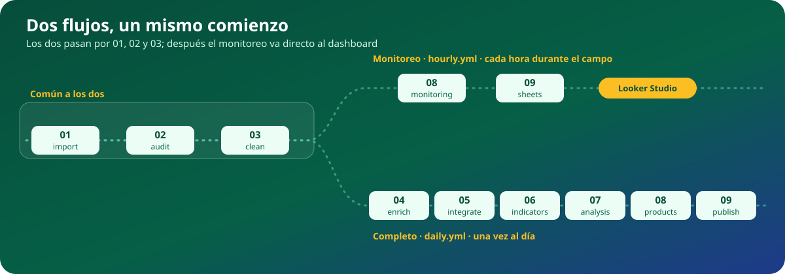
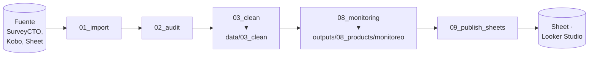

**La estructura y el flujo de datos que siguen nuestros proyectos de datos.**

Se clona, se renombra y se completa. Sirve igual para una encuesta de una sola ronda que para un proyecto con varias fuentes, varias rondas y análisis.

> [!NOTE]
> **Por ahora el repositorio solo define la estructura.** Los scripts tienen su encabezado, pero todavía no tienen contenido.

---

## Contenido

1. [Cómo usar este blueprint](#1-cómo-usar-este-blueprint)
2. [El flujo de los datos](#2-el-flujo-de-los-datos)
3. [Las etapas](#3-las-etapas)
4. [Dónde queda cada cosa](#4-dónde-queda-cada-cosa)
5. [Estructura del repositorio](#5-estructura-del-repositorio)
6. [Reglas que no se negocian](#6-reglas-que-no-se-negocian)

---

## 1. Cómo usar este blueprint

1. **Use this template** en GitHub y nombrar el repositorio `pipeline_<proyecto>`.
2. Renombrar `dataops-blueprint.Rproj` a `<proyecto>.Rproj`.
3. Borrar las etapas que el proyecto no usa (su carpeta en `src/` y `data/`, y su paso en los workflows). **Los números de las demás no cambian.**
4. Copiar `.secrets/.Renviron.example` como `.secrets/.Renviron`, completar los valores y dejar la clave de Google en `.secrets/`.
5. Completar `sources/rondas.csv` y dejar el instrumento en `sources/01_instrumento/`.
6. Completar `.claude/CONTEXTO_PROYECTO.md` y el README siguiendo `.claude/skills/skill_readme.md`.
7. Llenar `src/00_setup/packages.R` y correr `renv::init()` para generar `renv.lock`.

Este blueprint es para **proyectos con datos tabulares**. Un proyecto cualitativo o de revisión de literatura no usa estas etapas.

---

## 2. El flujo de los datos

Hay **dos flujos**, que comparten las tres primeras etapas y corren con workflows distintos:

| Flujo | Para qué | Etapas | Workflow | Cuándo |
|---|---|---|---|---|
| **Monitoreo** | seguir el campo mientras ocurre: avance, cuotas, alertas, encuestadores | `01` → `02` → `03` → `08_monitoring` → `09_publish_sheets` | `hourly.yml` | cada hora, solo mientras dura el levantamiento |
| **Completo** | la base final, el análisis y las entregas | `01` → `02` → … → `06` → `07` → `08` → `09` | `daily.yml` | una vez al día, o a mano al cierre |

### 2.1 Flujo de monitoreo

Es corto a propósito: corre cada hora y tiene que terminar rápido. Lee la base **limpia pero sin filtrar**: están todos los intentos, con sus alertas y su clasificación, porque el monitoreo mide el proceso de campo, incluidas las encuestas inválidas. Las etapas `04` a `07` no participan.

### 2.2 Flujo completo

Se lee en cuatro bloques:

| Bloque | Etapas | Qué pasa | Escribe en |
|---|---|---|---|
| **1. Ingesta** | `01` | se traen los datos de cada fuente, tal cual llegan | `data/01_raw/` |
| **2. Procesar** | `02` a `06` | se auditan, limpian, enriquecen e integran hasta dejar la base final; cada script lee lo que dejó el anterior | `data/02_audit/` a `data/06_final/` |
| **3. Producir** | `07` y `08` | se analiza la base final y se arma lo que mira o recibe una persona | `outputs/` |
| **4. Publicar** | `09` | se lleva cada cosa a su destino; no se calcula nada | Sheets, Drive, Pages |

El flujo de monitoreo (sección 2.1) recorre los mismos bloques, pero corto: ingesta (`01`), procesar solo hasta `03_clean`, producir solo `08_monitoring` y publicar solo el Sheet.

---

## 3. Las etapas

Cada etapa responde **una sola pregunta**. Si una tarea no responde la pregunta de la etapa, no va ahí.

| # | Etapa | La pregunta que responde | Lee | Escribe | ¿Se puede saltar? |
|---|---|---|---|---|---|
| `00` | `setup` | ¿Qué necesita todo script para correr? | — | — | No |
| `01` | `import` | ¿Qué llegó de la fuente? | la fuente | `data/01_raw/` | No |
| `02` | `audit` | ¿Está bien lo que llegó? | `data/01_raw/` | `data/02_audit/` | Sí |
| `03` | `clean` | ¿Cómo queda usable, una fuente a la vez? | `data/02_audit/` | `data/03_clean/` | No |
| `04` | `enrich` | ¿Qué le agregamos desde afuera? | `data/03_clean/` | `data/04_enrich/` | Sí |
| `05` | `integrate` | ¿Cómo se unen fuentes y rondas? | `data/04_enrich/` | `data/05_integrate/` | Sí |
| `06` | `indicators` | ¿Qué variables e indicadores necesitamos? | la última etapa | `data/06_final/` | No |
| `07` | `analysis` | ¿Qué resultados obtenemos? | `data/06_final/` | `outputs/07_analysis/` | Sí |
| `08` | `products` | ¿Qué mira o recibe una persona? | `data/06_final/`, `outputs/07_analysis/` | `outputs/08_products/` | Sí |
| `09` | `publish` | ¿Dónde tiene que estar? | `outputs/`, `data/` | Sheets, Drive, Pages | Sí |

Lo que hace cada una, y sobre todo lo que **no** hace:

- **`01_import`** descarga tal cual. **No** filtra ni corrige. Si la fuente responde con error, corta sin pisar el crudo anterior.
- **`02_audit`** marca. **No** corrige ni borra: agrega columnas de alerta y clasifica cada registro. Aplica los veredictos humanos.
- **`03_clean`** corrige, normaliza y etiqueta **una fuente a la vez**. **No** carga ninguna otra fuente.
- **`04_enrich`** agrega información que la fuente no trae: IA, geocodificación, APIs externas. **No** vuelve a procesar lo que no cambió.
- **`05_integrate`** une fuentes y rondas: apila, cruza, deduplica, resuelve quién es quién. **No** crea indicadores.
- **`06_indicators`** crea variables derivadas, indicadores y scores sobre la base integrada, y deja la base final en dos versiones: la analítica y la de entrega sin datos personales. **No** limpia.
- **`07_analysis`** calcula resultados: modelos, índices, cruces. Guarda tablas y figuras; **nunca** quedan solo en pantalla.
- **`08_products`** arma lo que mira una persona: tablas del dashboard, informes, diccionario, base de entrega.
- **`09_publish`** lleva cada cosa a su destino. **No** calcula nada.

**`04_enrich` frente a `06_indicators`:** las dos agregan columnas, pero `04` trae información **de afuera** (IA, APIs, geocodificación), una fuente a la vez y antes de integrar; `06` calcula con lo que **ya está adentro**, después de integrar, cuando ya están todas las fuentes y rondas juntas. Las recodificaciones simples de una sola fuente (tramos de edad, grupos de NPS) se quedan en `03_clean`.

**Los números no se corren.** Si un proyecto no tiene enriquecimiento, no existe `04_enrich`, y `05_integrate` sigue siendo `05`. Así, en todos los proyectos `03` es limpieza y `06` es la base final.

---

## 4. Dónde queda cada cosa

La regla es **qué es y quién lo lee**:

| Si es… | Va en | Nombre del archivo | En git |
|---|---|---|---|
| una base de datos que lee otro script | `data/0N_<etapa>/` | fijo, se sobrescribe en cada corrida | no, solo las carpetas |
| un resultado, tabla, gráfico o informe | `outputs/0N_<etapa>/<nombre>/` | con fecha, se acumula | no, solo las carpetas |
| algo que lee un sistema (Looker, la web) | su destino: Sheets, Drive, Pages | lo decide el destino | — |
| un insumo que entra de afuera | `sources/` | lo decide el equipo | sí |

**En `data/` solo van bases de datos.** Ninguna tabla de resultados, gráfico ni informe.

`data/06_final/` es la **frontera**: de ahí para atrás todo es preparación; de ahí para adelante, todo usa la base final. La única excepción es el flujo de monitoreo (`08_monitoring_*`), que lee de `data/03_clean/` porque mide el proceso de campo mientras ocurre (sección 2.1).

---

## 5. Estructura del repositorio

Haz clic en una carpeta para desplegarla (hasta cuatro niveles) y pasa el mouse sobre cualquier nombre para ver su definición completa. Cada nombre lleva a la carpeta o al archivo en el repositorio; los marcados sin enlace son locales o los genera el pipeline. Para buscar y ver el detalle de cada carpeta y de cada etapa, abre el **[explorador interactivo](https://piero-valles-maravi.github.io/dataops-blueprint/)**.

<code>&lt;proyecto&gt;/</code> · la raíz del repositorio

<ul>
  <li><a href="README.md" title="La puerta de entrada al proyecto: qué hace, en qué estado está, cómo fluyen los datos y cómo correrlo. Se actualiza en el mismo commit que cualquier cambio de estructura."><code>README.md</code></a> · qué es, cómo se usa y cómo está armado</li>
  <li><a href="dataops-blueprint.Rproj" title="Archivo del proyecto de R. Al clonar se renombra como &lt;proyecto&gt;.Rproj. Fija la carpeta de trabajo en la raíz del repositorio, así las rutas relativas funcionan igual en local y en GitHub Actions."><code>dataops-blueprint.Rproj</code></a> · abre el proyecto en RStudio o Positron</li>
  <li><code>renv.lock</code> · versiones exactas de los paquetes</li>
  <li><a href=".gitignore" title="Ignora el contenido de data/ y outputs/ (pero conserva sus carpetas con .gitkeep), todo .secrets/ salvo la plantilla, la librería de renv, los borradores y los archivos temporales de R, Excel y el sistema."><code>.gitignore</code></a> · qué NO se sube a git</li>
  <li>

<a href=".claude" title="Todo lo que Claude necesita para trabajar en el proyecto sin preguntar lo mismo cada vez. Se versiona con el proyecto; la configuración personal (settings.local.json) no se sube."><code>.claude/</code></a> · contexto y reglas para programar con Claude

  <ul>
    <li><a href=".claude/CLAUDE.md" title="Reglas cortas que Claude lee al iniciar cada sesión: dónde está el contexto, qué skill usar para cada tarea y que hay que actualizar CONTEXTO_PROYECTO.md al terminar."><code>CLAUDE.md</code></a> · qué leer al empezar y qué actualizar al terminar</li>
    <li><a href=".claude/CONTEXTO_PROYECTO.md" title="Archivo vivo con el estado ACTUAL del proyecto: ficha del cliente, estado de cada etapa, decisiones de diseño con su porqué, pendientes y una bitácora con fecha absoluta. Si una sección queda obsoleta, se reescribe."><code>CONTEXTO_PROYECTO.md</code></a> · ficha, estado, decisiones, pendientes, bitácora</li>
    <li>

<a href=".claude/skills" title="Las skills del equipo, como archivos sueltos. CLAUDE.md dice cuál leer antes de cada tipo de tarea."><code>skills/</code></a> · cómo se hace cada tarea

    <ul>
      <li><a href=".claude/skills/skill_project_structure.md" title="Dónde va cada script, carpeta o archivo, y cómo se numeran."><code>skill_project_structure.md</code></a> · dónde va cada cosa</li>
      <li><a href=".claude/skills/skill_code_style.md" title="Cabeceras, secciones, un mutate() por paso, comentarios, sufijos, construcciones prohibidas."><code>skill_code_style.md</code></a> · estilo de código R</li>
      <li><a href=".claude/skills/skill_audit.md" title="Las etapas de 02_audit y las 10 dimensiones de calidad, con alertas 0/1, clasificación final y veredicto humano."><code>skill_audit.md</code></a> · cómo se audita</li>
      <li><a href=".claude/skills/skill_data_cleaning.md" title="Reglas no negociables, bloques de llave, tabla de correcciones y trampas que ya costaron caro."><code>skill_data_cleaning.md</code></a> · cómo se limpia una fuente</li>
      <li><a href=".claude/skills/skill_readme.md" title="Orden de secciones, banner, badges, tablas y diagramas Mermaid."><code>skill_readme.md</code></a> · cómo se escribe el README</li>
      <li><a href=".claude/skills/skill_readme_banner.svg" title="La plantilla SVG del banner: se copia a .github/images/ y se cambian los textos."><code>skill_readme_banner.svg</code></a> · plantilla del banner</li>
    </ul>
    
</li>
  </ul>
  
</li>
  <li>

<a href=".github" title="Lo que usa GitHub: las imágenes del README y los workflows de GitHub Actions."><code>.github/</code></a> · imágenes del README y automatización

  <ul>
    <li>

<a href=".github/images" title="Las imágenes de ESTE proyecto que muestra el README. Los gráficos de resultados no van aquí: van en outputs/."><code>images/</code></a> · banner y figuras del README

    <ul>
      <li><a href=".github/images/banner.svg" title="El banner del proyecto, hecho con la plantilla de skill_readme_banner.svg."><code>banner.svg</code></a> · portada del README</li>
      <li><a href=".github/images/flujo_completo.svg" title="Los cuatro bloques (Ingesta, Procesar, Producir, Publicar) en orden."><code>flujo_completo.svg</code></a> · animación del flujo completo</li>
      <li><a href=".github/images/flujos.svg" title="El flujo de monitoreo y el completo, que comparten 01 a 03 y se separan después."><code>flujos.svg</code></a> · animación de los dos flujos</li>
    </ul>
    
</li>
    <li>

<a href=".github/workflows" title="Cada workflow solo llama scripts, un paso por script, sin lógica propia. Comparten el grupo de concurrencia, así nunca corren dos a la vez."><code>workflows/</code></a> · automatización: un workflow por frecuencia

    <ul>
      <li><a href=".github/workflows/hourly.yml" title="01_import → 02_audit → 03_clean → 08_monitoring → 09_publish_sheets. Corre solo mientras dura el campo; lo dispara tools/apps_script."><code>hourly.yml</code></a> · flujo de monitoreo, cada hora</li>
      <li><a href=".github/workflows/daily.yml" title="01_import → … → 06_indicators → 08_products → 09_publish, con el respaldo en Drive. 07_analysis se corre a mano al cierre."><code>daily.yml</code></a> · flujo completo, una vez al día</li>
      <li><a href=".github/workflows/dashboard.yml" title="Opcional. Publica tools/dashboard/ en GitHub Pages cada vez que cambia. Requiere activar Pages con la fuente GitHub Actions."><code>dashboard.yml</code></a> · publica tools/dashboard en Pages</li>
    </ul>
    
</li>
  </ul>
  
</li>
  <li>

<a href=".secrets" title="El único lugar con valores secretos. En git solo van .gitkeep y la plantilla; en GitHub Actions las mismas variables llegan como secrets con el mismo nombre."><code>.secrets/</code></a> · credenciales (casi nada se sube)

  <ul>
    <li><a href=".secrets/.Renviron.example" title="La plantilla: se copia como .Renviron y se completa. Tiene todas las variables que usa el proyecto."><code>.Renviron.example</code></a> · los nombres de las variables, sin valores</li>
    <li><code>.Renviron</code> · (local) los valores</li>
    <li><code>cuenta_servicio.json</code> · (local) la clave de Google</li>
  </ul>
  
</li>
  <li>

<a href="sources" title="Lo que entra de afuera y no cambia con cada corrida. Se versiona en git, así que nunca lleva datos personales."><code>sources/</code></a> · insumos que el pipeline NO produce

  <ul>
    <li><a href="sources/rondas.csv" title="ronda, formid, fechas, instrumento y estado (cerrada, activa, pendiente). La ronda activa es la que procesan los workflows; el piloto es una ronda más."><code>rondas.csv</code></a> · una fila por ronda</li>
    <li>

<a href="sources/01_instrumento" title="Los XLSForm, uno por ronda y versión: &lt;ronda&gt;_&lt;version&gt;.xlsx. Definen columnas, saltos, opciones y etiquetas, y los lee leer_instrumento(ronda)."><code>01_instrumento/</code></a> · el cuestionario de cada ronda

    <ul>
      <li><code>&lt;ronda&gt;_&lt;version&gt;.xlsx</code> · XLSForm de la ronda</li>
    </ul>
    
</li>
    <li><a href="sources/02_referencias" title="Tablas que el equipo edita sin tocar código: vocabularios controlados, metas por país, umbrales, usuarios de prueba, prompts de IA."><code>02_referencias/</code></a> · catálogos, metas, umbrales, prompts</li>
    <li><a href="sources/03_correcciones" title="Correcciones puntuales sin datos personales: ronda, id, variable, valor nuevo, motivo, autor y fecha. Las que llevan datos personales llegan por un Sheet privado."><code>03_correcciones/</code></a> · correcciones del analista</li>
  </ul>
  
</li>
  <li>

<a href="src" title="Una carpeta por etapa, con el mismo número que la carpeta de data/ que escribe. Los archivos _encuesta, _registro, etc. son ejemplos: cada proyecto los renombra según sus fuentes."><code>src/</code></a> · todo el código del pipeline

  <ul>
    <li><a href="src/00_master.R" title="Solo para probar en local. En producción corren los workflows, un paso por script."><code>00_master.R</code></a> · corre los dos flujos en orden</li>
    <li>

<a href="src/00_setup" title="Tres archivos, cada uno con una sola responsabilidad."><code>00_setup/</code></a> · lo que carga todo script

    <ul>
      <li><a href="src/00_setup/packages.R" title="Carga los paquetes; las versiones quedan en renv.lock."><code>packages.R</code></a> · solo paquetes</li>
      <li><a href="src/00_setup/functions.R" title="env_requerido(), ronda_activa(), leer_instrumento(), leer_etapa(), guardar_etapa(). Cargarlo no ejecuta nada."><code>functions.R</code></a> · solo funciones</li>
      <li><a href="src/00_setup/auth.R" title="Cuenta de servicio de Google, sin login interactivo. Solo la cargan los scripts que usan Google."><code>auth.R</code></a> · solo autenticación</li>
    </ul>
    
</li>
    <li>

<a href="src/01_import" title="Trae los datos de cada fuente sin filtrar ni corregir. Si la fuente falla, corta sin pisar el crudo anterior."><code>01_import/</code></a> · un script por fuente: descarga tal cual

    <ul>
      <li><a href="src/01_import/01_import_encuesta.R" title="SurveyCTO o Kobo; el formid sale de sources/rondas.csv."><code>01_import_encuesta.R</code></a> · la encuesta</li>
      <li><a href="src/01_import/01_import_registro.R" title="Un registro administrativo, un padrón o el Sheet del cliente."><code>01_import_registro.R</code></a> · una segunda fuente</li>
      <li><a href="src/01_import/01_import_validacion.R" title="La validación de las supervisoras y las correcciones con datos personales."><code>01_import_validacion.R</code></a> · las decisiones humanas</li>
    </ul>
    
</li>
    <li>

<a href="src/02_audit" title="Marca cada registro con alertas 0/1 agrupadas en 10 dimensiones, sin corregir ni borrar. Ver skill_audit.md."><code>02_audit/</code></a> · un script por fuente: marca alertas

    <ul>
      <li><a href="src/02_audit/02_audit_encuesta.R" title="Aplica las correcciones humanas, calcula las dimensiones, clasifica (alerta_final) y suma el veredicto (resultado_final)."><code>02_audit_encuesta.R</code></a> · auditoría de la encuesta</li>
      <li><a href="src/02_audit/02_audit_registro.R" title="Solo las dimensiones que aplican a un registro: completitud, validez, consistencia, duplicados, atípicos."><code>02_audit_registro.R</code></a> · auditoría del registro</li>
    </ul>
    
</li>
    <li>

<a href="src/03_clean" title="Corrige, normaliza y etiqueta una fuente a la vez, sin cruzarla con otras. Su salida la lee también el flujo de monitoreo."><code>03_clean/</code></a> · un script por fuente: corrige y etiqueta

    <ul>
      <li><a href="src/03_clean/03_clean_encuesta.R" title="Etiquetas del instrumento, códigos especiales (-666, -999, -555) y correcciones de sources/03_correcciones."><code>03_clean_encuesta.R</code></a> · limpieza de la encuesta</li>
      <li><a href="src/03_clean/03_clean_registro.R" title="Deja las mismas columnas comunes que la encuesta, para que integrar sea apilar."><code>03_clean_registro.R</code></a> · limpieza del registro</li>
    </ul>
    
</li>
    <li>

<a href="src/04_enrich" title="Agrega lo que la fuente no trae: IA, geocodificación, APIs. Es idempotente: no reprocesa (ni paga) lo que no cambió. Opcional."><code>04_enrich/</code></a> · un script por fuente: información de afuera

    <ul>
      <li><a href="src/04_enrich/04_enrich_encuesta.R" title="Por ejemplo, clasificar respuestas abiertas."><code>04_enrich_encuesta.R</code></a> · IA sobre la encuesta</li>
      <li><a href="src/04_enrich/04_enrich_registro.R" title="Por ejemplo, geocodificar direcciones."><code>04_enrich_registro.R</code></a> · datos externos del registro</li>
    </ul>
    
</li>
    <li>

<a href="src/05_integrate" title="Apila, cruza, deduplica y resuelve quién es quién. No crea indicadores. Con una sola fuente y una ronda, no existe."><code>05_integrate/</code></a> · pasos con subíndice: une fuentes y rondas

    <ul>
      <li><a href="src/05_integrate/05_integrate_1_apilar.R" title="Junta todo en una base con _fuente y _ronda."><code>05_integrate_1_apilar.R</code></a> · apila fuentes y rondas</li>
      <li><a href="src/05_integrate/05_integrate_2_entidades.R" title="Une los registros de la misma persona o entidad y deja una llave única."><code>05_integrate_2_entidades.R</code></a> · resuelve quién es quién</li>
    </ul>
    
</li>
    <li>

<a href="src/06_indicators" title="Calcula con lo que ya está en la base integrada (04 trae de afuera; 06 calcula adentro). Deja la frontera: data/06_final."><code>06_indicators/</code></a> · un script por tema: indicadores y base final

    <ul>
      <li><a href="src/06_indicators/06_indicators_variables.R" title="La base final analítica."><code>06_indicators_variables.R</code></a> · variables, indicadores, scores</li>
      <li><a href="src/06_indicators/06_indicators_entrega.R" title="Solo registros válidos y sin datos personales, verificado con stop()."><code>06_indicators_entrega.R</code></a> · versión de entrega</li>
    </ul>
    
</li>
    <li>

<a href="src/07_analysis" title="Modelos, índices y cruces. Lee solo de data/06_final y guarda todo en outputs/07_analysis. Se corre a mano."><code>07_analysis/</code></a> · un script por análisis

    <ul>
      <li><a href="src/07_analysis/07_analysis_descriptivos.R" title="Escribe con el prefijo descriptivos_."><code>07_analysis_descriptivos.R</code></a> · descriptivos y cruces</li>
      <li><a href="src/07_analysis/07_analysis_modelo.R" title="Regresión, conjoint, Van Westendorp o un índice compuesto; prefijo modelo_."><code>07_analysis_modelo.R</code></a> · el modelo o índice</li>
    </ul>
    
</li>
    <li>

<a href="src/08_products" title="Lo que mira o recibe una persona."><code>08_products/</code></a> · un script por producto

    <ul>
      <li><a href="src/08_products/08_monitoring.R" title="Única excepción a la frontera: lee de data/03_clean para medir el campo mientras ocurre."><code>08_monitoring.R</code></a> · tablas del monitoreo</li>
      <li><a href="src/08_products/08_products_informe.R" title="Tablas y figuras de 07 más los indicadores de la base final."><code>08_products_informe.R</code></a> · el informe</li>
      <li><a href="src/08_products/08_products_entrega.R" title="La base de entrega en .xlsx, .csv y .dta, con su diccionario."><code>08_products_entrega.R</code></a> · la entrega al cliente</li>
    </ul>
    
</li>
    <li>

<a href="src/09_publish" title="Lleva cada cosa a donde se mira. No calcula nada."><code>09_publish/</code></a> · un script por destino

    <ul>
      <li><a href="src/09_publish/09_publish_sheets.R" title="Esquema de columnas fijo, para que Looker no se rompa."><code>09_publish_sheets.R</code></a> · el Sheet del dashboard</li>
      <li><a href="src/09_publish/09_publish_drive.R" title="Una carpeta de Drive por etapa de data/, con la fecha en el nombre."><code>09_publish_drive.R</code></a> · el respaldo en Drive</li>
    </ul>
    
</li>
  </ul>
  
</li>
  <li>

<a href="data" title="Lo que produce el pipeline y lee otro script. En git van solo las carpetas. Nada de tablas de resultados, gráficos ni informes."><code>data/</code></a> · SOLO bases de datos .RData

  <ul>
    <li>

<a href="data/01_raw" title="Una subcarpeta por ronda."><code>01_raw/</code></a> · lo que llegó, tal cual

    <ul>
      <li><a href="data/01_raw/piloto" title="Los datos de piloto en esta etapa. El nombre coincide con la fila de sources/rondas.csv: el código es uno solo y la ronda es un parámetro."><code>piloto/</code></a> · datos de piloto</li>
      <li><a href="data/01_raw/ronda_1" title="Los datos de ronda_1 en esta etapa. El nombre coincide con la fila de sources/rondas.csv: el código es uno solo y la ronda es un parámetro."><code>ronda_1/</code></a> · datos de ronda_1</li>
      <li><a href="data/01_raw/ronda_2" title="Los datos de ronda_2 en esta etapa. El nombre coincide con la fila de sources/rondas.csv: el código es uno solo y la ronda es un parámetro."><code>ronda_2/</code></a> · datos de ronda_2</li>
      <li><a href="data/01_raw/ronda_3" title="Los datos de ronda_3 en esta etapa. El nombre coincide con la fila de sources/rondas.csv: el código es uno solo y la ronda es un parámetro."><code>ronda_3/</code></a> · datos de ronda_3</li>
    </ul>
    
</li>
    <li>

<a href="data/02_audit" title="Una subcarpeta por ronda."><code>02_audit/</code></a> · cada fuente con sus alertas

    <ul>
      <li><a href="data/02_audit/piloto" title="Los datos de piloto en esta etapa. El nombre coincide con la fila de sources/rondas.csv: el código es uno solo y la ronda es un parámetro."><code>piloto/</code></a> · datos de piloto</li>
      <li><a href="data/02_audit/ronda_1" title="Los datos de ronda_1 en esta etapa. El nombre coincide con la fila de sources/rondas.csv: el código es uno solo y la ronda es un parámetro."><code>ronda_1/</code></a> · datos de ronda_1</li>
      <li><a href="data/02_audit/ronda_2" title="Los datos de ronda_2 en esta etapa. El nombre coincide con la fila de sources/rondas.csv: el código es uno solo y la ronda es un parámetro."><code>ronda_2/</code></a> · datos de ronda_2</li>
      <li><a href="data/02_audit/ronda_3" title="Los datos de ronda_3 en esta etapa. El nombre coincide con la fila de sources/rondas.csv: el código es uno solo y la ronda es un parámetro."><code>ronda_3/</code></a> · datos de ronda_3</li>
    </ul>
    
</li>
    <li>

<a href="data/03_clean" title="Una subcarpeta por ronda. Es lo que lee el flujo de monitoreo."><code>03_clean/</code></a> · cada fuente limpia

    <ul>
      <li><a href="data/03_clean/piloto" title="Los datos de piloto en esta etapa. El nombre coincide con la fila de sources/rondas.csv: el código es uno solo y la ronda es un parámetro."><code>piloto/</code></a> · datos de piloto</li>
      <li><a href="data/03_clean/ronda_1" title="Los datos de ronda_1 en esta etapa. El nombre coincide con la fila de sources/rondas.csv: el código es uno solo y la ronda es un parámetro."><code>ronda_1/</code></a> · datos de ronda_1</li>
      <li><a href="data/03_clean/ronda_2" title="Los datos de ronda_2 en esta etapa. El nombre coincide con la fila de sources/rondas.csv: el código es uno solo y la ronda es un parámetro."><code>ronda_2/</code></a> · datos de ronda_2</li>
      <li><a href="data/03_clean/ronda_3" title="Los datos de ronda_3 en esta etapa. El nombre coincide con la fila de sources/rondas.csv: el código es uno solo y la ronda es un parámetro."><code>ronda_3/</code></a> · datos de ronda_3</li>
    </ul>
    
</li>
    <li>

<a href="data/04_enrich" title="Una subcarpeta por ronda, con la base y su _hist (la memoria para no reprocesar)."><code>04_enrich/</code></a> · cada fuente con la información agregada

    <ul>
      <li><a href="data/04_enrich/piloto" title="Los datos de piloto en esta etapa. El nombre coincide con la fila de sources/rondas.csv: el código es uno solo y la ronda es un parámetro."><code>piloto/</code></a> · datos de piloto</li>
      <li><a href="data/04_enrich/ronda_1" title="Los datos de ronda_1 en esta etapa. El nombre coincide con la fila de sources/rondas.csv: el código es uno solo y la ronda es un parámetro."><code>ronda_1/</code></a> · datos de ronda_1</li>
      <li><a href="data/04_enrich/ronda_2" title="Los datos de ronda_2 en esta etapa. El nombre coincide con la fila de sources/rondas.csv: el código es uno solo y la ronda es un parámetro."><code>ronda_2/</code></a> · datos de ronda_2</li>
      <li><a href="data/04_enrich/ronda_3" title="Los datos de ronda_3 en esta etapa. El nombre coincide con la fila de sources/rondas.csv: el código es uno solo y la ronda es un parámetro."><code>ronda_3/</code></a> · datos de ronda_3</li>
    </ul>
    
</li>
    <li>

<a href="data/05_integrate" title="Ya sin subcarpetas por ronda."><code>05_integrate/</code></a> · todas las fuentes y rondas juntas

    <ul>
      <li><code>&lt;proyecto&gt;_integrate.RData</code> · base .RData</li>
    </ul>
    
</li>
    <li>

<a href="data/06_final" title="La única carpeta que leen 07_analysis y 08_products."><code>06_final/</code></a> · la frontera

    <ul>
      <li><code>&lt;proyecto&gt;_final.RData</code> · base .RData</li>
      <li><code>&lt;proyecto&gt;_entrega.RData</code> · base .RData</li>
    </ul>
    
</li>
  </ul>
  
</li>
  <li>

<a href="outputs" title="Resultados de 07 y productos de 08, para una persona. En git van solo las carpetas; cada archivo lleva fecha y no se sobrescribe."><code>outputs/</code></a> · todo lo que NO es base de datos

  <ul>
    <li>

<a href="outputs/07_analysis" title="Todos los análisis juntos; cada archivo lleva el nombre del análisis como prefijo."><code>07_analysis/</code></a> · resultados de todos los análisis

    <ul>
      <li>

<a href="outputs/07_analysis/tablas" title="Estimaciones y cruces."><code>tablas/</code></a> · tablas de resultados

      <ul>
        <li><code>descriptivos_&lt;tabla&gt;.csv</code> · una tabla</li>
      </ul>
      
</li>
      <li>

<a href="outputs/07_analysis/figuras" title="Guardados con ggsave(), nunca solo en pantalla."><code>figuras/</code></a> · gráficos

      <ul>
        <li><code>modelo_&lt;figura&gt;.png</code> · una figura</li>
      </ul>
      
</li>
    </ul>
    
</li>
    <li>

<a href="outputs/08_products" title="Lo que se entrega o se mira."><code>08_products/</code></a> · una carpeta por producto

    <ul>
      <li><a href="outputs/08_products/monitoreo" title="Las sube 09_publish_sheets al Sheet que lee Looker."><code>monitoreo/</code></a> · tablas del campo</li>
      <li>

<a href="outputs/08_products/informe" title="Ej.: informe_2026-11-02.docx."><code>informe/</code></a> · informes con fecha

      <ul>
        <li><code>informe_&lt;aaaa-mm-dd&gt;.docx</code> · un informe</li>
      </ul>
      
</li>
      <li>

<a href="outputs/08_products/entrega" title="Una subcarpeta por corte."><code>entrega/</code></a> · entregas al cliente

      <ul>
        <li><code>entrega_&lt;aaaa-mm-dd&gt;/</code> · una entrega</li>
      </ul>
      
</li>
    </ul>
    
</li>
  </ul>
  
</li>
  <li>

<a href="tools" title="Opcional: lo que no es R ni corre en el pipeline."><code>tools/</code></a> · código que corre fuera del pipeline

  <ul>
    <li>

<a href="tools/apps_script" title="Google Apps Script que lanza los workflows a su hora, porque el cron de GitHub no es confiable."><code>apps_script/</code></a> · el disparador de los workflows

    <ul>
      <li><a href="tools/apps_script/disparador.gs" title="El token va en las propiedades del script, nunca en el código."><code>disparador.gs</code></a> · el script</li>
    </ul>
    
</li>
    <li>

<a href="tools/dashboard" title="En el blueprint trae el explorador interactivo de esta estructura; un proyecto lo reemplaza por su dashboard propio."><code>dashboard/</code></a> · página web en GitHub Pages

    <ul>
      <li><a href="tools/dashboard/index.html" title="Se publica con .github/workflows/dashboard.yml."><code>index.html</code></a> · la página</li>
    </ul>
    
</li>
  </ul>
  
</li>
</ul>

El repositorio trae scripts de ejemplo en cada carpeta de `src/` (una encuesta y un registro como fuentes) y las subcarpetas `piloto/`, `ronda_1/`, `ronda_2/` y `ronda_3/` en `data/01_raw` a `04_enrich`: cada proyecto los renombra o borra según sus fuentes y rondas. Si una corrida deja varios archivos de un mismo producto, van en una subcarpeta con la fecha de corte.

---

## 6. Reglas que no se negocian

- [ ] El número del script es el mismo que el de la carpeta que escribe.
- [ ] Cada etapa lee **solo** la anterior que exista y escribe **solo** en su carpeta.
- [ ] Los números no se corren: si una etapa no aplica, se borra.
- [ ] En `data/` solo van bases de datos.
- [ ] `07` y `08` leen **solo** de `data/06_final/` (salvo `08_monitoring_*`, que lee de `03_clean`).
- [ ] Nada que produzca el pipeline va en `sources/`.
- [ ] Ninguna credencial, id, UUID ni dato personal en un script: todo sale de `.secrets/.Renviron`, `sources/` o una fuente importada.
- [ ] `.Renviron.example` tiene todas las variables que usa el proyecto.
- [ ] El código es uno solo para todas las rondas.
- [ ] Ningún `View()`, `setwd()` ni ruta con fecha fija en el pipeline; la exploración va en `src/borradores/`.
- [ ] Ningún script de más de ~1.500 líneas: se divide con subíndice.
- [ ] `00_master` es para probar en local; en producción, un paso del workflow por script.
- [ ] El README y `CONTEXTO_PROYECTO.md` se actualizan en el mismo commit que el cambio.
